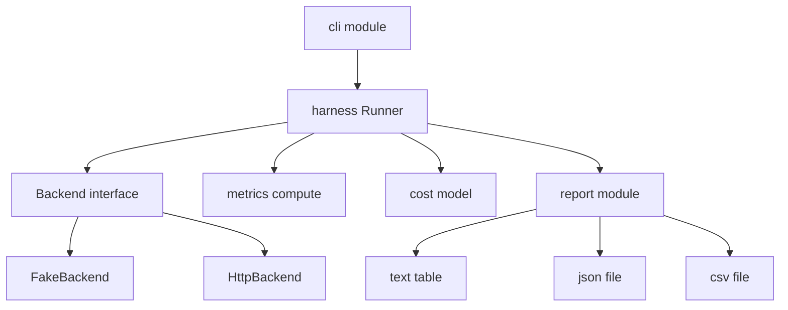
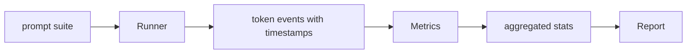

# llm-benchmark

[](https://github.com/theraihanrakibb/llm-benchmark/actions/workflows/ci.yml)
[](LICENSE)
[](https://www.python.org/)

**llm-bench** is a production-quality, dependency-light benchmark & evaluation
harness for LLM serving. It measures the three numbers platform teams actually
care about when they compare providers or decide whether to self-host:

- **Latency** — Time To First Token (TTFT) and Time Per Output Token (TPOT).
- **Throughput** — generated tokens per second.
- **Cost** — USD per request and normalised USD per 1M tokens.

It ships with a deterministic, network-free `FakeBackend` (so CI never needs a
GPU, downloaded weights, or an API key) and a fully implemented `HttpBackend`
that speaks the OpenAI-compatible streaming API over `httpx`.

---

## Why this matters for AI infra

Before a platform team commits to a provider — or to a self-hosted vLLM / TGI /
TensorRT-LLM stack — it needs reproducible evidence about the *shape* of the
serving cost and latency. Headline "tokens/sec" marketing numbers hide the real
story:

- **TTFT** determines perceived interactivity for chat / agentic UIs. A model
  that is fast per-token but slow to start feels sluggish.
- **TPOT** and **throughput** determine how many concurrent users a single GPU
  can serve and therefore your marginal cost per request.
- **$/1M tokens** is the number finance and procurement argue over, and it is
  only meaningful when normalised against a *real* prompt/completion mix.

`llm-bench` encodes exactly this measurement loop as code: run a fixed prompt
suite, aggregate mean / median / p95, and emit a report you can diff in PRs.
That turns "our provider feels slow" into a tracked, version-controlled metric.

---

## Architecture





---

## Quickstart

```bash
# 1. Install
pip install -r requirements.txt

# 2. Run a deterministic demo benchmark (no network, no API key)
python -m llm_bench.cli run --backend fake --runs 5

# 3. Run over a prompts file with pricing
python -m llm_bench.cli run --backend fake \
    --prompts prompts.txt --runs 10 \
    --model gpt-4o --price-in 5 --price-out 15

# 4. Emit machine-readable reports
python -m llm_bench.cli run --backend fake --runs 3 --format json --output report.json
python -m llm_bench.cli run --backend fake --runs 3 --format csv  --output report.csv
```

Run the test suite:

```bash
python -m pytest -q
```

Run it in Docker (the image runs a demo benchmark on start):

```bash
docker build -t llm-bench .
docker run --rm llm-bench
```

---

## CLI reference

```
llm-bench run [options]

  --backend {fake,http}      Backend to use (default: fake)
  --prompts PATH             Prompts file, one prompt per non-empty line
  --runs N                   Repetitions per prompt (default: 5)
  --model NAME               Model label / name
  --price-in FLOAT           Input price USD per 1M tokens
  --price-out FLOAT          Output price USD per 1M tokens
  --format {text,json,csv}   Report format (default: text)
  --output PATH              Write report to file (default: stdout)
  --base-url URL             [http] OpenAI-compatible base URL
  --api-key KEY              [http] API key (or OPENAI_API_KEY env)
```

### Example against a real OpenAI-compatible endpoint

```bash
export OPENAI_API_KEY=sk-...
python -m llm_bench.cli run --backend http \
    --model gpt-4o --prompts prompts.txt --runs 20 \
    --price-in 5 --price-out 15 --format json --output gpt4o.json
```

---

## API reference

```python
from llm_bench.backends import FakeBackend
from llm_bench.cost import Price
from llm_bench.harness import Runner
from llm_bench.report import render_json

backend = FakeBackend(ttft=0.1, tpot=0.05)
price = Price(input_per_1m=5.0, output_per_1m=15.0)
runner = Runner(backend=backend, prompts=["Hello"], runs=10, price=price)
agg, results = runner.run()

print(agg.ttft_mean, agg.throughput_mean, agg.cost_per_1m)
report = render_json(agg, results)  # dict -> json.dumps(...)
```

Key types:

- `Backend` — abstract interface; `stream(prompt, model=None) -> Iterator[TokenEvent]`.
- `FakeBackend` — deterministic, configurable `ttft` / `tpot`, injectable clock.
- `HttpBackend` — OpenAI-compatible SSE streaming via `httpx` (injectable client).
- `compute_metrics(events, start_ts)` — returns a `Metrics` dataclass.
- `Price`, `cost_for_request`, `cost_per_1m` — pricing model.
- `Runner`, `aggregate`, `RunResult`, `Aggregate` — harness + stats.
- `render_text` / `render_json` / `render_csv` / `write_report` — reporting.

---

## Metrics definitions

| Metric | Formula |
| --- | --- |
| TTFT | `first_token_timestamp - start_timestamp` |
| TPOT | `(last_token_timestamp - first_token_timestamp) / (num_tokens - 1)` |
| Throughput | `num_tokens / generation_time` |
| Total latency | `last_token_timestamp - start_timestamp` |
| Cost / request | `input/1M*price_in + output/1M*price_out` |
| $/1M tokens | `cost_for_request * 1_000_000 / total_tokens` |

> Token counting for prompts uses a dependency-free whitespace heuristic. Swap
> in a real tokenizer (e.g. `tiktoken`) for exact accounting in production.

---

## Future work

- Real tokenizer support (`tiktoken` / `tokenizers`) behind a pluggable
  `TokenCounter` interface.
- Concurrent / rate-limited load mode (`--concurrency N`) to measure saturated
  throughput and queueing behaviour.
- Provider adapters (Anthropic, Gemini, self-hosted vLLM) as built-in backends.
- Statistical stability guard: auto-extend `--runs` until p95 stabilises.
- HTML dashboard + historical trend storage for regression tracking in CI.

---

## License

[MIT](LICENSE) © MD RAKIBUL ISLAM RAIHAN
